# Gestor de tareas del curso — Angular

Informe de investigación y mini aplicación del framework **Angular**.

## Contenido

1. [Panorama](#1-panorama)
2. [Instalación](#2-instalación)

---

## 1. Panorama

### Ficha técnica

| Campo | Detalle |
|---|---|
| Framework | Angular |
| Mantenido por | Google, con un equipo dedicado y la comunidad |
| Versión usada | Angular CLI 22.2.5 (Node.js 24.18.0, npm 11.16.0) |
| Licencia | MIT |
| Lenguaje | TypeScript |
| Filosofía | Framework completo ("baterías incluidas") |
| Documentación | <https://angular.dev> |

### ¿Qué es Angular?

Angular es un framework que ayuda a los desarrolladores a trabajar rápido. Está mantenido por un equipo dedicado de Google y ofrece un amplio conjunto de librerías y APIs que simplifican el flujo de trabajo. Es una plataforma sólida y rápida de construir, escalable tanto a nivel de equipo como de base de código.

Permite crear aplicaciones para varias plataformas:

- **Web:** SPA, SSR y SSG.
- **Móvil:** Ionic, NativeScript.
- **Escritorio:** Electron.

### Filosofía: framework completo

Angular trae todo lo necesario para construir una aplicación (enrutador, cliente HTTP, formularios, inyección de dependencias, pruebas) sin depender de librerías de terceros.

### Bloques fundamentales

**Componentes.** Son las piezas de la interfaz de usuario. Cada componente combina lógica en TypeScript, estilos en CSS y una plantilla HTML.

**Rutas.** Permiten cambiar entre páginas. Cada ruta apunta normalmente a un componente que ocupa toda la vista, lo que separa la aplicación en pantallas pequeñas. También permiten controlar el acceso y la autorización, y definir estrategias de renderizado.

**Directivas.** Modifican el comportamiento de un elemento HTML. Hay tres tipos:

- *De atributo:* cambian la apariencia o el comportamiento de un elemento (`ngClass`, `ngStyle`).
- *Estructurales:* cambian la estructura del DOM mediante el control de flujo (`@if`, `@for`).
- *Componentes:* son directivas con plantilla propia, es decir, directivas personalizadas.

**Servicios.** Encapsulan la lógica y centralizan el acceso y la gestión de los datos. Permiten reutilizar código e inyectar dependencias en los componentes.

**Módulos.** Agrupan funcionalidades relacionadas para reutilizarlas después. Organizan la aplicación, encapsulan dependencias y facilitan la carga de partes de la app. En las versiones modernas los componentes son *standalone* y los módulos son opcionales.

**Pipes.** Transforman datos para mostrarlos de forma visual en los componentes:

- *Puros:* se ejecutan solo cuando cambia el valor de entrada.
- *Impuros:* se ejecutan en cada ciclo de detección de cambios.

**Señales computadas (`computed`).** Son señales de solo lectura cuyo valor se recalcula únicamente cuando cambian las señales de las que dependen.

**Eventos.** Se enlazan con paréntesis en la plantilla, por ejemplo `(click)="metodo()"`. El uso más común es con botones.

### Árbol de un proyecto Angular

- La carpeta `src/app` contiene normalmente toda la aplicación.
- Las *pages* son componentes que cubren la pantalla completa y se referencian en `app.routes.ts`.
- `app.config.ts` contiene la configuración de la aplicación.
- En `index.html` toda la aplicación se monta dentro de la etiqueta `<app-root>`.

---

## 2. Instalación

Angular ofrece una versión en el navegador para aprender, llamada *playground*. Para trabajar en local se necesitan:

- **Node.js** — [v22.22.3 o superior](https://angular.dev/reference/versions)
- **Editor de texto** — [Visual Studio Code](https://code.visualstudio.com/)
- **Terminal** — necesaria para los comandos de [Angular CLI](https://angular.dev/tools/cli)
- **Herramienta de desarrollo** — se recomienda el [Angular Language Service](https://angular.dev/tools/language-service)

La guía paso a paso está en la página oficial: <https://angular.dev/installation>

### Versiones del entorno

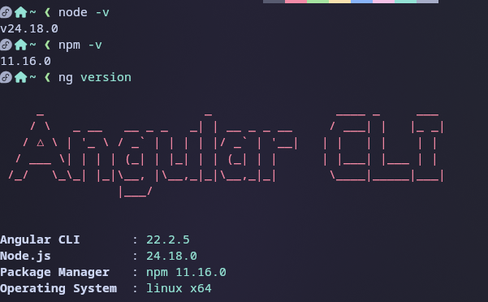

| Herramienta | Versión |
|---|---|
| Node.js | 24.18.0 |
| npm | 11.16.0 |
| Angular CLI | 22.2.5 |
| Sistema operativo | Linux x64 (Fedora) |

### Paso 1. Instalar Angular CLI

```bash
sudo npm install -g @angular/cli
```

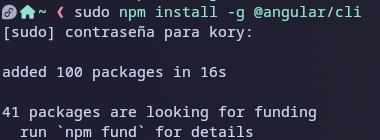

### Paso 2. Crear un proyecto de prueba

Antes del proyecto real se creó uno de prueba para entender el entorno:

```bash
ng new my-first-angular-app
```

Opciones elegidas en el asistente: autocompletado de la CLI (Sí), compartir datos de uso (Sí), hoja de estilos **CSS**, SSR y SSG (Sí), herramientas de IA (Ninguna).

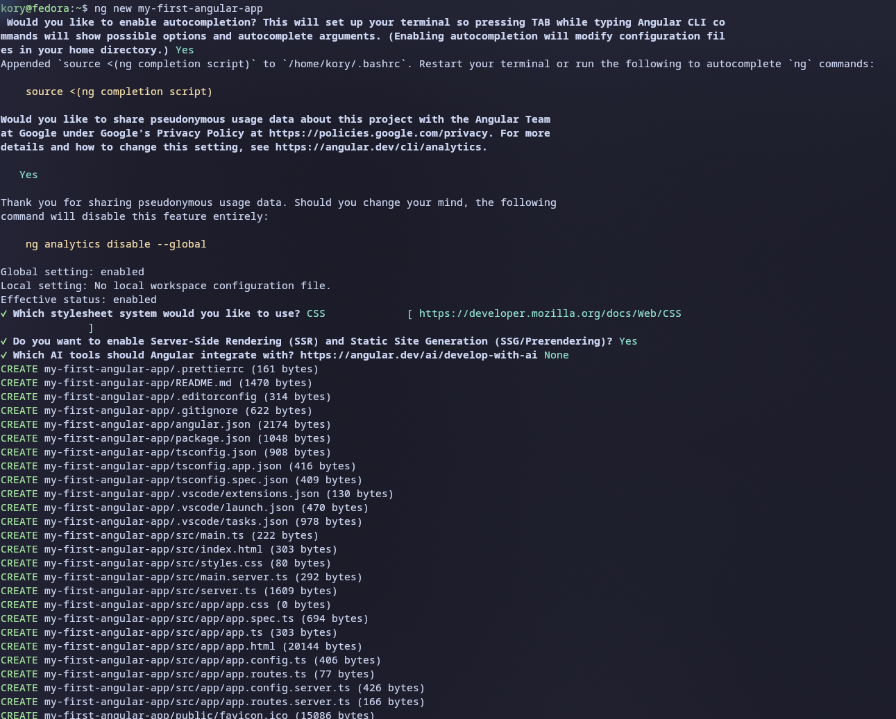

### Paso 3. Ejecutar el proyecto

```bash
cd my-first-angular-app
npm start      # equivale a: ng serve
```

La CLI compila la aplicación y levanta el servidor de desarrollo en `http://localhost:4200`.

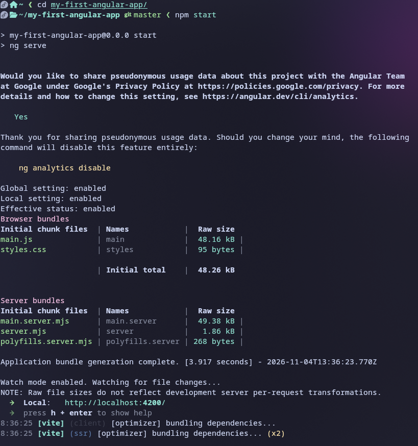

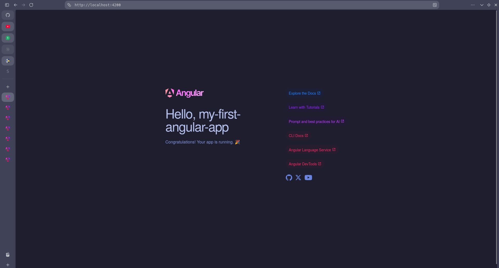

### Estructura de carpetas del proyecto de prueba

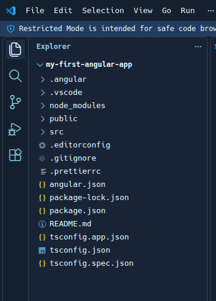

| Elemento | Función |
|---|---|
| `src/` | Código fuente de la aplicación |
| `src/app/` | Componentes, rutas y configuración |
| `public/` | Archivos estáticos (favicon, imágenes) |
| `angular.json` | Configuración del workspace y de la CLI |
| `package.json` | Dependencias y scripts de npm |
| `tsconfig*.json` | Configuración de TypeScript |
| `.angular/` | Caché de compilación |
| `node_modules/` | Dependencias instaladas |

### Proyecto real: `gestor-tareas-angular`

Con el entorno comprendido se creó el proyecto de la mini aplicación y se ejecutó con:

```bash
ng serve -o
```

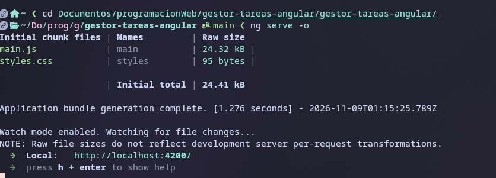

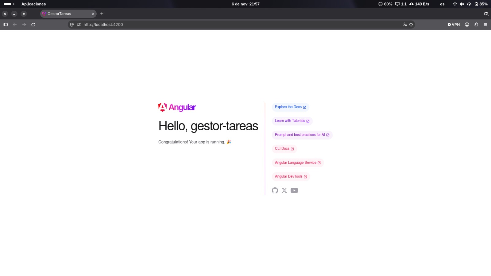

Sobre la estructura base se añadieron las carpetas propias de la aplicación dentro de `src/app/`: `componentes/`, `modelos/` y `servicios/`, además de `db.json` para JSON Server.

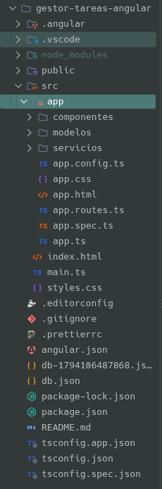

### Hola mundo explicado línea por línea

#### `src/index.html`

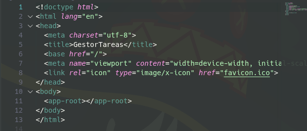

| Línea | Explicación |
|---|---|
| `<!doctype html>` | Declara que el documento es HTML5. |
| `<html lang="en">` | Elemento raíz; `lang` indica el idioma del documento. |
| `<meta charset="utf-8">` | Codificación de caracteres. |
| `<title>GestorTareas</title>` | Título que aparece en la pestaña del navegador. |
| `<base href="/">` | Ruta base para que el enrutador de Angular resuelva correctamente las URL. |
| `<meta name="viewport" ...>` | Hace que la página se adapte al ancho del dispositivo (diseño responsive). |
| `<link rel="icon" ...>` | Ícono de la pestaña (`favicon.ico`). |
| `<app-root></app-root>` | Punto de montaje: Angular inserta aquí toda la aplicación. |

#### `src/main.ts`

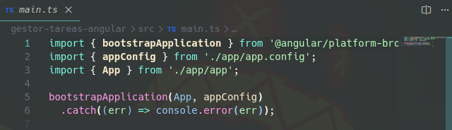

| Línea | Explicación |
|---|---|
| `import { bootstrapApplication } from '@angular/platform-browser'` | Función que arranca la aplicación en el navegador. |
| `import { appConfig } from './app/app.config'` | Configuración global (proveedores, enrutador, etc.). |
| `import { App } from './app/app'` | Componente raíz de la aplicación. |
| `bootstrapApplication(App, appConfig)` | Arranca la app usando `App` como componente raíz y aplicando `appConfig`. |
| `.catch((err) => console.error(err))` | Muestra en consola cualquier error durante el arranque. |

#### `src/app/app.ts`

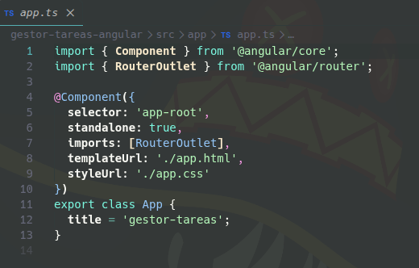

| Línea | Explicación |
|---|---|
| `import { Component } from '@angular/core'` | Importa el decorador `@Component`. |
| `import { RouterOutlet } from '@angular/router'` | Directiva que muestra el componente de la ruta activa. |
| `@Component({ ... })` | Decorador que convierte la clase en un componente y define sus metadatos. |
| `selector: 'app-root'` | Nombre de la etiqueta HTML del componente (la de `index.html`). |
| `standalone: true` | El componente no necesita un módulo; declara sus propias dependencias. |
| `imports: [RouterOutlet]` | Dependencias que puede usar en su plantilla. |
| `templateUrl: './app.html'` | Archivo con la plantilla HTML. |
| `styleUrl: './app.css'` | Archivo con los estilos del componente. |
| `export class App { title = 'gestor-tareas'; }` | Clase con la lógica; `title` es la propiedad que se muestra en la plantilla. |

### Mediciones de la instalación

| Métrica | Valor |
|---|---|
| Tiempo de configuración inicial | __ min *(completar)* |
| Tamaño inicial del bundle en desarrollo (`ng serve`, gestor-tareas) | 24.41 kB (`main.js` 24.32 kB + `styles.css` 95 bytes) |
| Tiempo de compilación inicial (gestor-tareas) | 1.276 s |

> Los tamaños de `ng serve` son del servidor de desarrollo; el tamaño del build de producción se medirá con `ng build`.

### Errores encontrados

Durante la instalación no apareció ningún error, ya que se siguió la guía oficial de Angular paso a paso.
